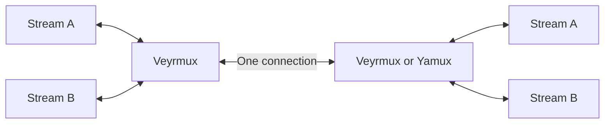

# Veyrmux

Veyrmux is a Tokio-native Rust **stream multiplexer**, compatible with Yamux v0.
A muxer carries many independent, bidirectional byte streams over one ordered
connection instead of opening a connection for each stream.



Streams have independent flow control and half-close; they still share the
transport's head-of-line blocking. Payloads are opaque byte streams, not messages.
Veyrmux itself forbids unsafe Rust.

## Use with Tokio

Requires Rust 1.89 or newer. Add the verified revision:

```toml
[dependencies]
veyrmux = { git = "https://github.com/alexandernicholson/veyrmux", rev = "6a3e9f66fb896cc56dc60696d14f774657f1cd04" }
```

- Wrap a Tokio `AsyncRead + AsyncWrite + Unpin` transport with
  `Connection::new(transport, config, Mode::Client)` or `Mode::Server`.
- Continuously poll `poll_next_inbound` to drive transport I/O and receive streams,
  **including on outbound-only connections**.
- Use `poll_new_outbound` to open streams and `poll_close` to drain and close.
  Streams implement Tokio `AsyncRead` and `AsyncWrite`.
- Reading returns receive credit. Closing one direction preserves the other;
  dropping an unfinished stream sends RST without closing sibling streams.

See the [connection driver and echo example](examples/support/mod.rs) for a
complete lifecycle, and [the runnable example](examples/bench.rs) for usage.

## Moving from Yamux

The [Yamux v0 wire format](https://github.com/hashicorp/yamux/blob/master/spec.md)
is unchanged; Veyrmux interoperates with stock Yamux peers.

For existing Futures-I/O code, enable `features = ["futures-compat"]` and use:

```rust
use veyrmux::yamux_shim as yamux;
```

This exposes Futures-I/O `Connection` and `Stream` adapters, not Yamux's entire API.
The adapter announces outbound streams on first I/O, like Yamux; the native Tokio
API announces them when opened.

## Limits

Defaults: 512 active streams, a fixed 256 KiB receive window per stream,
16 KiB outgoing DATA payloads, and a 1 MiB pending-wire budget including
in-progress writes. Reset cleanup may add one header per active stream.

[`Config`](src/session.rs) controls stream admission and send/receive budgets.
The connection receive budget reserves fixed stream windows; it does not enable
window auto-tuning. `set_split_send_size` accepts 1..=256 KiB; caller slices,
credit and queue space can shorten a frame. Invalid configuration is rejected
when opening or driving the connection.

## Latest benchmarks

Linux x86_64, Rust 1.100.0, release with thin LTO; both endpoints share one Tokio
current-thread runtime. Each run validates 4 GiB: 1 MiB request and echo per stream,
eight streams, 256 rounds. Both engines use 16 KiB DATA/caller buffers and 256 KiB
receive windows.

| Transport | Veyrmux, ms ± σ | Yamux 0.13.10, ms ± σ |
|---|---:|---:|
| TCP loopback | 620.8 ± 9.3 | 1113.8 ± 46.1 |
| In-memory duplex, 64 KiB | 318.7 ± 8.5 | 397.1 ± 2.7 |

Hyperfine process times include startup and warmup: 12 Veyrmux runs, three Yamux
runs, one warmup per block. These bulk results are workload-specific, not network
capacity or a latency guarantee.
[Measurements and methodology](results/linux-lookahead-sizing/summary.json).

Reproduce from this checkout with Hyperfine installed:

```sh
./scripts/bench.sh 1048576 8 256 tcp
./scripts/bench.sh 1048576 8 256 duplex
```

## License

[MIT](LICENSE).

